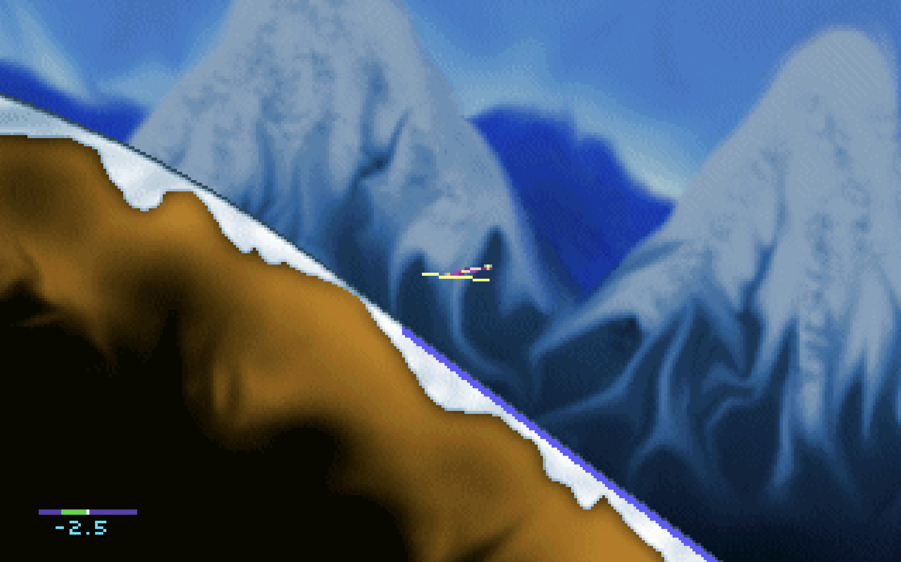

# Ski Jump International v3 (remake)

This repository is a complete rewrite of the legendary DOS game Ski Jump International v3.

It has all of the game, and you can play it on the desktop and in web browsers: https://akheron.github.io/skijump3-remake



Also check out [the original game's website](https://www.nomasi.com/sj3/).

## Goals

The main goal of this project is to port the game to mobile web browsers.

Why does it need a complete rewrite? The original game is written in Pascal and is DOS-only.
An [SDL2 port exists](https://github.com/suomipelit/skijump3-sdl), but the combination of Pascal and SDL is not possible
to compile to web browsers.

## How?

The remake is written in Rust.

It's a line-by-line rewrite of version SP4 of the SDL2 port of the original Pascal code. Trace
replays check that it behaves the same as the Pascal code (see [Tracing](#tracing)). It's portable
through a trait that abstracts platform specific details.

The available platforms are SDL2 and web (through WebAssembly).

One novel idea in the port is using Rust's async/await to allow unwinding of the deeply nested
game loop. This is required to return control to the top level after each frame when running in
web browsers.

Things still left to do:

- The game is not yet playable on mobile browsers. This would require a touch UI.
- The changes of the SDL2 port after version SP4 are not ported.
- There are low hanging fruits for performance improvements and to make the code more idiomatic Rust.

## Development

Desktop:

1. Install SDL development library
2. Run `cargo run --bin desktop`

The game reads its data files from `assets/` in the current directory. The
files that the game writes go to a data directory, and the game reads a file
from there first. A file that the game removes from `assets/` is hidden by a
line in `.removed` in the data directory. The data directory is the
`SJ3_DATA_DIR` environment variable or the preferences directory of SDL:

- Linux: `$XDG_DATA_HOME/skijump3-remake`, by default
  `~/.local/share/skijump3-remake`
- macOS: `~/Library/Application Support/skijump3-remake`
- Windows: `%APPDATA%\skijump3-remake`

These keys of the SDL2 port control the window:

| Key | Description |
| --- | --- |
| Alt+Enter | Toggle fullscreen |
| Alt+(Keypad) Plus | Increase window size |
| Alt+(Keypad) Minus | Decrease window size |
| Alt+R | Reset window if stretched |
| Alt+A | Toggle 4:3 aspect ratio |

Command line options:

| Option | Description |
| --- | --- |
| `-s`, `--sw-rendering` | Use software rendering |
| `-r` | Reset the hiscores |
| `-z` | Reset the hiscores to zero points |
| `-c` | Reset the settings |

The game reads `-r`, `-z` and `-c` only from the first argument, and only its
second character, as the original game does. Thus `/r` also works.

Web:

1. Install `wasm-bindgen-cli`, with the same version as `wasm-bindgen` in
   `Cargo.lock`: `cargo install wasm-bindgen-cli --version 0.2.129`
2. Build and serve:

```
cd web
./build.sh
python -m http.server -d dist
```

The web build reads the data files from `dist/assets.pack`. It keeps the files
that the game writes in the localStorage of the browser.

### Structure

The port follows the Pascal code line by line:

- Each Pascal unit has one Rust module, for example `SJ3UNIT.PAS` is
  `unit.rs`.
- The functions of a module are in the same order as in the implementation
  section of the Pascal unit.
- The names are the Pascal names in lower case. Finnish names and the Pascal
  comments stay.
- A nested Pascal procedure is a closure or a private method directly before
  its outer function.
- Arrays keep the Pascal index range: `array[1..5]` is a Rust array of 6
  elements that the code indexes with 1 to 5.
- Where Pascal arithmetic overflows and wraps, use `wrapping_*` or the same
  casts, so that debug builds do not panic where Pascal continues.
- Procedures that render or wait for keys are `async fn`.
- A Rust helper that has no Pascal equivalent goes below its callers.

### Floating point

The original game stores its floating point variables as `single`, and the
Borland Pascal 7 build of the DOS version computes each expression in 80-bit
x87 precision. To get the same results on all platforms, the variables are
`f32`, each expression is computed in `f64`, and the result is rounded to
`f32` where the original stores a `single`: in an assignment, in a `single`
parameter or in a function result.

- `help::round` is the game's own `round`. It takes a `single`, so its
  argument is rounded to `f32` first.
- `help::round_half_even` is the built-in `Round` of Turbo Pascal, which the
  units that do not use SJ3HELP call.
- Use `libm` for `sin` and `cos`, so that all platforms compute the same values.

### Tracing

The desktop build can replay a trace from the `sp4-trace` branch of the SDL
port, and check that the game state, the written files, the console text and
every frame match. Keypresses, random numbers, the clock and the files that the
game finds come from the trace. Run it in a directory without
`assets`, and with a data directory that has the same data files that the
Pascal game started with:

```
cargo build --release -p desktop --features trace
SJ3_DATA_DIR=/path/to/data SJ3_TRACE=/path/to/Trace.txt /path/to/target/release/desktop
```

It stops at the first difference, or prints `Trace replay complete` at the
`End` line of the trace. It compares the CRC of each frame with the trace. If
`SJ3_FRAMES` is the directory of the frame dumps of the Pascal run, it also
tells how a frame that differs differs from the dump.

[`trace/README.md`](trace/README.md) tells how to build the Pascal reference,
run scenarios and run the regression set.
